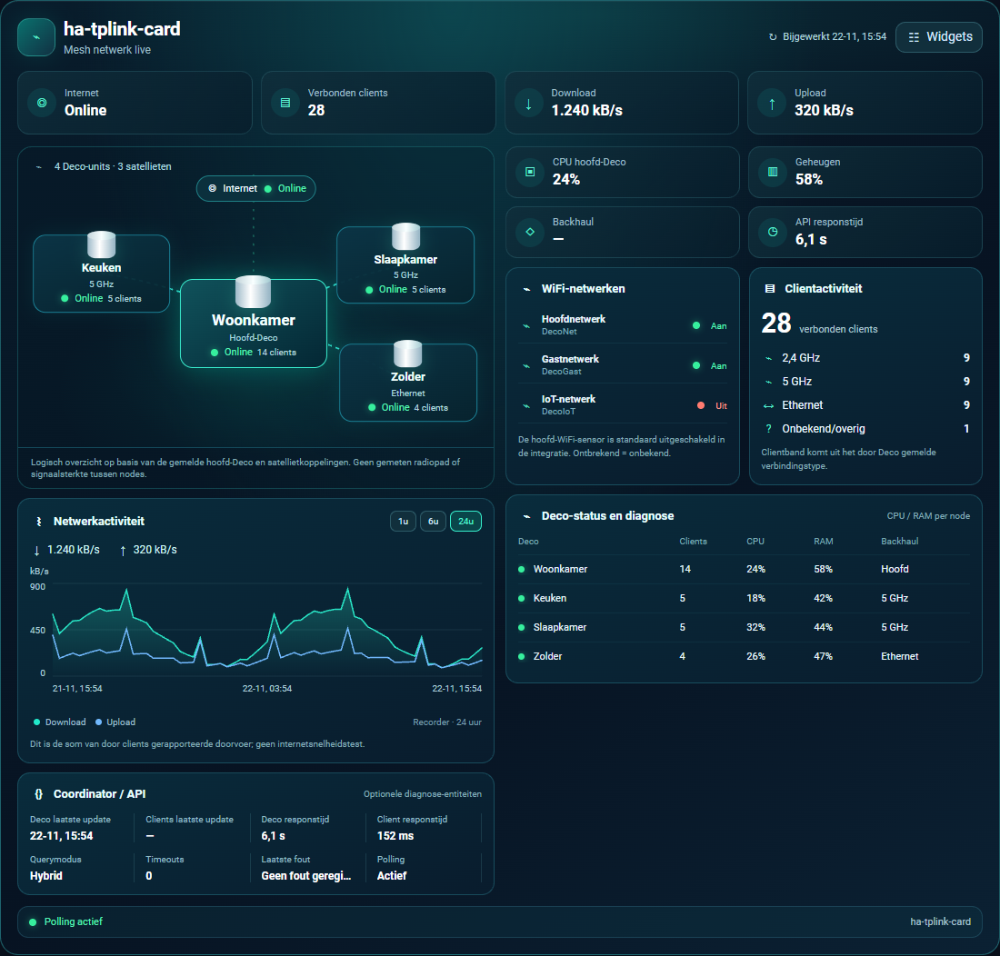
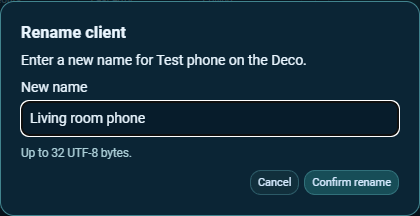

# ha-tplink-card

[English](#english) · [Nederlands](#nederlands) · [Wide layout](#make-the-card-wider) · [Brede weergave](#maak-de-kaart-breder)

[WLAN auf Deutsch](#wlan-auf-deutsch) · [Wi-Fi en français](#wi-fi-en-français)



[Mobile screenshot / Mobiele screenshot](docs/screenshots/mobile.png)

## English

A Home Assistant dashboard card for your TP-Link Deco mesh. It shows logical mesh relationships, connected clients, throughput, Wi-Fi state, and API diagnostics using Home Assistant data. The topology shows logical relationships. Throughput reflects client traffic reported by Deco.

### Requirements

- Home Assistant with support for custom dashboard cards.
- For read-only monitoring, use [amosyuen/ha-tplink-deco](https://github.com/amosyuen/ha-tplink-deco), [dkwolf1/ha-deco](https://github.com/dkwolf1/ha-deco), or another integration that provides compatible `tplink_deco` entities. The card needs Deco and client device trackers to show the mesh and its clients. CPU, memory, backhaul, Wi-Fi, and API sensors depend on your model and may be disabled by default.
- Optional controls require `dkwolf1/ha-deco` with the corresponding Home Assistant action. Blocking and unblocking are available from [v4.0.0](https://github.com/dkwolf1/ha-deco/releases/tag/v4.0.0). Renaming is available from [v4.1.0](https://github.com/dkwolf1/ha-deco/releases/tag/v4.1.0).
- History requires Home Assistant Recorder to record the total download and upload sensors. Live data remains available without history.

### Installation

#### Using Marketplace

1. In Home Assistant 2026.11 or later, go to **Settings → Marketplace** and search for **ha-tplink-card**.
2. Open the card and select **Install**. If you manage dashboard resources in YAML, use the JavaScript module shown in the installation dialog.
3. Reload the browser and choose **ha-tplink-card** from **Add card**.

The card is in the default catalog. You can also open its listing directly. If it is missing from your Marketplace catalog, use **Add from link** with `https://github.com/dkwolf1/ha-tplink-card`. [Marketplace listing](https://my.home-assistant.io/redirect/marketplace_repository/?owner=dkwolf1&repository=ha-tplink-card&category=plugin) · [HACS listing](https://my.home-assistant.io/redirect/hacs_repository/?owner=dkwolf1&repository=ha-tplink-card&category=plugin) · [Marketplace guide](https://www.home-assistant.io/integrations/marketplace/)

#### Manual installation

1. Download [`tplink-deco-mesh-card.js`](https://github.com/dkwolf1/ha-tplink-card/releases/latest/download/tplink-deco-mesh-card.js) from the latest release and copy it to `/config/www/tplink-deco-mesh-card.js`. Restart Home Assistant once if you just created the `www` folder.
2. Under **Settings → Dashboards → ⋮ → Resources**, add `/local/tplink-deco-mesh-card.js?v=2.0.0` as a **JavaScript module**. For a later release, use that release's version number.
3. Reload the browser and add **ha-tplink-card** from the card picker.

The same file is in the ZIP on the [release page](https://github.com/dkwolf1/ha-tplink-card/releases/latest) and under [`dist/`](dist/tplink-deco-mesh-card.js) in the repository. Keep one dashboard resource for the card. When switching from a manual test installation to Marketplace, remove the old resource and keep your card configuration. [Register dashboard resources](https://contributors.home-assistant.io/frontend/custom-ui/resources/)

### Configure the card

The card editor sets the title, layout, mesh entry, history range and visible sections. The card and editor follow your Home Assistant profile language. They support English, Dutch, German and French, with English as the fallback.

Minimal configuration:

```yaml
type: custom:tplink-deco-mesh-card
```

The [extended example](examples/dashboard.yaml) includes history, sections, and an optional label and sensor override. Replace example entity IDs before enabling overrides. Select a Deco to open its details. Hover, tap or focus the plot and use the arrow keys to inspect measurements.

### Optional client controls

Client controls are available from card version `v1.5.0`. The card is read-only by default. With [ha-deco v4.0.0](https://github.com/dkwolf1/ha-deco/releases/tag/v4.0.0) or later, a Home Assistant administrator can enable **Allow blocking and unblocking clients** in the card editor or set:

```yaml
type: custom:tplink-deco-mesh-card
client_controls: true
```

Under **Client controls**, an administrator can block or unblock known clients on the selected mesh, including offline clients with a tracker. Keep the **Clients** section visible. If you have several meshes, choose **Mesh installation** in the editor or set its exact `entry_id` in YAML before using the controls.

The card only shows controls when Home Assistant offers `tplink_deco.set_client_blocked` and the entity registry identifies the client's MAC and mesh. It always sends the matching `config_entry_id` with the call. Blocking asks for confirmation. The card displays the result verified by Deco or the error that Home Assistant returns. Connectivity and block status are independent. The confirmation reflects the last action in this card.

#### Rename a Deco client

Renaming is available from card version `v1.6.0`. It is off by default and can be enabled independently of blocking. Use [ha-deco v4.1.0 or later](https://github.com/dkwolf1/ha-deco/releases/tag/v4.1.0) with the `tplink_deco.rename_client` action. In the card editor, enable **Allow renaming Deco clients**, or set:

```yaml
type: custom:tplink-deco-mesh-card
client_rename: true
```

Keep **Clients** visible. With multiple meshes, choose **Mesh installation** in the editor or set `entry_id` in YAML. As a Home Assistant administrator, open **Client controls**, select **Rename** next to a connected client, enter a name of up to 32 UTF-8 bytes, and select **Confirm rename**. The card shows the action only when it can verify the client's mesh and MAC address.

This updates the name on the Deco and preserves the Home Assistant entity ID. The card shows any error and reflects the new name when Home Assistant next reports it.



### Wi-Fi channels and experimental optimization

**Breaking change for Wi-Fi preview builds in v2.0.0.** Upgrade the integration if your test build showed the popup with an older version.

The **Wi-Fi networks** panel shows the main Deco’s current channels and widths when reported. The **Wi-Fi scan and optimization** button requires [dkwolf1/ha-deco v4.2.0-beta.1 or later](https://github.com/dkwolf1/ha-deco/releases/tag/v4.2.0-beta.1) and compatible Wi-Fi entities for the selected main Deco. The card checks the installed version reported by Home Assistant. Current channels remain visible on earlier versions that report them.

Enable the experimental feature and configure the SSH host fingerprint in the integration. Home Assistant administrators can then use the available actions. For multiple meshes, select the relevant **Mesh installation** in the card editor.

- Open **Wi-Fi scan and optimization** to see the monitor. Inside, **Scan Wi-Fi** records the current readings and sends one scan request. The schematic animation follows the advice sensor, even while channel readings are unavailable. The card shows the request acknowledgement and scan outcome separately.
- **Optimize Wi-Fi** appears when Deco recommends it. The first press requests confirmation. Choose **Confirm Wi-Fi optimization** within 30 seconds from the same administrator account. Wi-Fi may briefly disconnect. The schematic animation follows Deco during optimization. Afterward the card compares the available readings. When a fresh report is unavailable, it labels the last reported value and shows whether that value matches the baseline.

Scan and optimization were validated with a Deco X50 hardware 1.0 running firmware 1.11.1 Build 26081714 Rel. 32981. Channel diagnostics and actions depend on your firmware and enabled entities.

### Make the card wider

Add **ha-tplink-card** through the card picker and leave **Layout** on **Automatic**. In a Sections dashboard, the card fills its section and fits its height to the content by default. At 800 px of card width, the topology and diagnostics appear side by side. On narrower cards they stack.

Home Assistant sets the space available to each card. To fill a whole tab, place this card alone on a **Panel (1 card)** tab. On an existing card, a saved size override in **Layout** still applies. Select **Use recommended size** to restore the new default. [Home Assistant Panel view](https://www.home-assistant.io/dashboards/panel/) · [Resizing a card](https://www.home-assistant.io/dashboards/cards/#resizing-a-card)

#### Widen an existing Sections dashboard

If the card fills one narrow section and leaves space next to it, edit the **view YAML**. Set `max_columns: 3` at the top level. Under `sections:`, update the section that already contains the card to match the structure below. Keep your other sections, cards, and settings.

```yaml
- type: grid
  column_span: 3
  cards:
    - type: custom:tplink-deco-mesh-card
      view: wide
      grid_options:
        columns: full
        rows: auto
```

`column_span: 3` lets that section span three columns when the screen has room. `columns: full` makes the card fill that section. If the card already uses `view: wide`, the key change is adding the section span.

### Updates and troubleshooting

- **Update** via Marketplace or replace the JS file and change the version in the resource URL. Reload the browser afterward.
- **Card missing.** Check the URL and JavaScript module type. A 404 indicates a missing file or incorrect path.
- **Wrong or missing units.** Verify the TP-Link Deco integration and select the relevant mesh if there is more than one.
- **Empty chart or diagnostics.** Verify that Recorder includes the traffic sensors and that the desired diagnostic entities are enabled.

### Local demo

Run `npm run demo` from this repository and open [the local demo](http://127.0.0.1:4173/demo/). The demo needs only Node.js 24 and uses fictional sample data.

## Nederlands

Een Home Assistant-dashboardkaart voor je TP-Link Deco-mesh. Bekijk de logische mesh-topologie, verbonden clients, doorvoer, WiFi-status en API-diagnostiek. De kaart toont gegevens uit Home Assistant. De lijnen geven logische koppelingen aan. Doorvoer is de activiteit die Deco voor clients rapporteert.

### Vereisten

- Home Assistant met ondersteuning voor aangepaste dashboardkaarten.
- Gebruik voor alleen-lezenweergave [amosyuen/ha-tplink-deco](https://github.com/amosyuen/ha-tplink-deco), [dkwolf1/ha-deco](https://github.com/dkwolf1/ha-deco) of een andere integratie die compatibele `tplink_deco`-entiteiten aanbiedt. De kaart gebruikt Deco- en clienttrackers om je mesh en verbonden apparaten weer te geven. Sensoren voor CPU, RAM, backhaul, wifi en de API verschillen per model en staan soms standaard uit.
- Voor optioneel clientbeheer heb je `dkwolf1/ha-deco` met de bijbehorende Home Assistant-actie nodig. Blokkeren en deblokkeren kan vanaf [v4.0.0](https://github.com/dkwolf1/ha-deco/releases/tag/v4.0.0). Hernoemen kan vanaf [v4.1.0](https://github.com/dkwolf1/ha-deco/releases/tag/v4.1.0).
- Voor de historie moeten de totale download- en uploadsensoren zijn opgenomen in Home Assistant Recorder. De live gegevens blijven ook zonder historie beschikbaar.

### Installeren

#### Via Marketplace

1. Ga in Home Assistant 2026.11 of nieuwer naar **Instellingen → Marketplace** en zoek op **ha-tplink-card**.
2. Open de kaart en kies **Installeren**. Beheer je dashboardbronnen via YAML, neem dan de JavaScript-module uit het installatievenster over.
3. Vernieuw je browser en voeg **ha-tplink-card** toe via **Kaart toevoegen**.

De kaart staat in de standaardcatalogus. Je kunt de vermelding ook rechtstreeks openen. Ontbreekt de kaart in jouw Marketplace-catalogus, kies dan **Toevoegen via link** en gebruik `https://github.com/dkwolf1/ha-tplink-card`. [Marketplace-vermelding](https://my.home-assistant.io/redirect/marketplace_repository/?owner=dkwolf1&repository=ha-tplink-card&category=plugin) · [HACS-vermelding](https://my.home-assistant.io/redirect/hacs_repository/?owner=dkwolf1&repository=ha-tplink-card&category=plugin) · [Marketplace-handleiding](https://www.home-assistant.io/integrations/marketplace/)

#### Handmatig

1. Download [`tplink-deco-mesh-card.js`](https://github.com/dkwolf1/ha-tplink-card/releases/latest/download/tplink-deco-mesh-card.js) uit de nieuwste release en kopieer het naar `/config/www/tplink-deco-mesh-card.js`. Herstart Home Assistant één keer als je de map `www` net hebt aangemaakt.
2. Voeg onder **Instellingen → Dashboards → ⋮ → Bronnen** de URL `/local/tplink-deco-mesh-card.js?v=2.0.0` toe als **JavaScript-module**. Gebruik bij een volgende release het versienummer van die release.
3. Vernieuw je browser en voeg **ha-tplink-card** toe via de kaartkiezer.

Hetzelfde bestand zit in het ZIP-pakket op de [releasepagina](https://github.com/dkwolf1/ha-tplink-card/releases/latest) en staat in de repo onder [`dist/`](dist/tplink-deco-mesh-card.js). Gebruik één dashboardbron. Als je overstapt van een handmatige testversie naar Marketplace, verwijder dan de oude bron en behoud je bestaande kaartconfiguratie. [Dashboardbronnen registreren](https://contributors.home-assistant.io/frontend/custom-ui/resources/)

### De kaart instellen

In de kaarteditor stel je titel, formaat, mesh-installatie, grafiekvenster en zichtbare secties in. De kaart en editor volgen de taal van je Home Assistant-profiel. Ze ondersteunen Engels, Nederlands, Duits en Frans. Voor overige talen gebruiken ze Engels.

Minimale configuratie:

```yaml
type: custom:tplink-deco-mesh-card
```

Het [uitgebreide voorbeeld](examples/dashboard.yaml) bevat het grafiekvenster, de secties en een optioneel label en sensor-override. Vervang de voorbeeld-entiteits-ID's voordat je die overrides gebruikt. Tik op een Deco voor details. Gebruik de muis, tik of geef de grafiek focus en gebruik de pijltjestoetsen voor meetwaarden.

### Optioneel clientbeheer

Clientbeheer is beschikbaar vanaf kaartversie `v1.5.0`. De kaart is standaard alleen-lezen. Met [ha-deco v4.0.0](https://github.com/dkwolf1/ha-deco/releases/tag/v4.0.0) of nieuwer kan een Home Assistant-beheerder **Clientbeheer toestaan** aanvinken in de kaarteditor of dit instellen:

```yaml
type: custom:tplink-deco-mesh-card
client_controls: true
```

Onder **Clientbeheer** kan een beheerder bekende clients op de gekozen mesh blokkeren en deblokkeren. Ook offline clients met een tracker staan in de lijst. Laat **Clients** aanstaan. Heb je meerdere meshes, kies dan de juiste **Mesh-installatie** in de editor of stel de exacte `entry_id` in via YAML.

De knoppen verschijnen alleen als Home Assistant `tplink_deco.set_client_blocked` aanbiedt en het entiteitenregister de client-MAC en mesh bevestigt. De kaart stuurt altijd de bijbehorende `config_entry_id` mee. Bij blokkeren vraagt de kaart om bevestiging. Je ziet de door Deco bevestigde uitkomst of de foutmelding. Online/offline staat los van de blokkeerstatus. De bevestiging geldt voor de laatste actie in deze kaart.

#### Een Deco-client hernoemen

Hernoemen is beschikbaar vanaf kaartversie `v1.6.0`. De functie staat standaard uit en kun je los van blokkeren aanzetten. Gebruik [ha-deco v4.1.0 of nieuwer](https://github.com/dkwolf1/ha-deco/releases/tag/v4.1.0) met de actie `tplink_deco.rename_client`. Vink **Deco-clients hernoemen toestaan** aan in de kaarteditor of gebruik:

```yaml
type: custom:tplink-deco-mesh-card
client_rename: true
```

Laat **Clients** zichtbaar. Kies bij meerdere meshes **Mesh-installatie** in de kaarteditor of stel `entry_id` in via YAML. Open als Home Assistant-beheerder **Clientbeheer**, kies **Hernoemen** bij een verbonden client, voer een naam van maximaal 32 UTF-8-bytes in en kies **Hernoemen bevestigen**. De kaart toont de optie alleen als ze de juiste mesh en het MAC-adres kan verifiëren.

De naam wijzigt op de Deco en de Home Assistant-entiteits-ID blijft gelijk. De kaart toont een eventuele fout en geeft de nieuwe naam weer zodra Home Assistant die doorgeeft. [Bekijk het hernoemvenster](docs/screenshots/client-rename.png)

### Wifi-kanalen en experimentele optimalisatie

**Breaking change voor wifi-testbuilds in v2.0.0.** Werk de integratie bij als je testbuild de popup bij een oudere versie toonde.

In **WiFi-netwerken** zie je de huidige kanalen en breedtes die de hoofd-Deco rapporteert. De knop **Wifi scannen en optimaliseren** vereist [dkwolf1/ha-deco v4.2.0-beta.1 of nieuwer](https://github.com/dkwolf1/ha-deco/releases/tag/v4.2.0-beta.1) en compatibele wifi-entiteiten voor de gekozen hoofd-Deco. De kaart controleert de geïnstalleerde versie die Home Assistant meldt. Huidige kanalen blijven ook zichtbaar op oudere versies die deze waarden rapporteren.

Schakel de experimentele functie in en stel de SSH-vingerafdruk in bij de integratie. Daarna kunnen Home Assistant-beheerders de beschikbare acties gebruiken. Kies bij meerdere meshes de juiste **Mesh-installatie** in de kaarteditor.

- Open **Wifi scannen en optimaliseren** om de monitor te bekijken. In de popup legt **Wifi scannen** de huidige waarden vast en stuurt het één scanverzoek. De schematische animatie volgt de adviessensor, ook als kanaalwaarden nog ontbreken. De kaart toont de ontvangstbevestiging en de scanuitkomst afzonderlijk.
- **Wifi optimaliseren** verschijnt zodra Deco dit aanbeveelt. De eerste klik vraagt om bevestiging. Kies binnen 30 seconden **Wifi-optimalisatie uitvoeren** met hetzelfde beheerdersaccount. Wifi kan kort wegvallen. Tijdens de optimalisatie volgt de schematische animatie de Deco-status. Daarna vergelijkt de kaart de beschikbare waarden. Als een vers rapport ontbreekt, toont de kaart de laatst gemelde waarde en geeft ze aan of die overeenkomt met de nulmeting.

Scannen en optimaliseren zijn gevalideerd op een Deco X50 hardware 1.0 met firmware 1.11.1 Build 26081714 Rel. 32981. Kanaaldiagnostiek en acties hangen af van de firmware en de ingeschakelde entiteiten.

### Maak de kaart breder

Voeg **ha-tplink-card** toe via de kaartkiezer en laat **Formaat** op **Automatisch** staan. Op een dashboard met secties vult de kaart standaard de hele sectie en past de hoogte zich aan de inhoud aan. Vanaf 800 px kaartbreedte staan topologie en diagnose naast elkaar. Bij minder ruimte staan ze onder elkaar.

Home Assistant bepaalt hoeveel ruimte elke kaart krijgt. Wil je dat de kaart een heel tabblad vult, plaats haar dan als enige kaart op een tabblad van het type **Paneel (1 kaart)**. Bij een bestaande kaart blijft een eerder ingestelde grootte onder **Indeling** gelden. Kies **Gebruik aanbevolen grootte** om de nieuwe standaard te gebruiken. [Paneelweergave](https://www.home-assistant.io/dashboards/panel/) · [Kaartgrootte aanpassen](https://www.home-assistant.io/dashboards/cards/#resizing-a-card)

#### Maak de kaart breder op een bestaand tabblad met secties

Vult de kaart één smalle sectie en blijft de ruimte ernaast leeg? Open de **YAML van het tabblad** en zet `max_columns: 3` op het hoogste niveau. Pas onder `sections:` de sectie met de kaart aan volgens het blok hieronder. Behoud je andere secties, kaarten en instellingen.

```yaml
- type: grid
  column_span: 3
  cards:
    - type: custom:tplink-deco-mesh-card
      view: wide
      grid_options:
        columns: full
        rows: auto
```

Met `column_span: 3` gebruikt die sectie drie kolommen zodra het scherm daar ruimte voor heeft. Met `columns: full` vult de kaart die sectie. Staat de kaart al op `view: wide`, dan is de ontbrekende sectiebreedte de instelling die je moet aanpassen.

### Updates en problemen oplossen

- **Update** de kaart via Marketplace of vervang handmatig het JS-bestand en wijzig het versienummer in de resource-URL. Vernieuw daarna de browser.
- **Kaart ontbreekt.** Controleer de URL en het type JavaScript-module. Een 404 wijst op een ontbrekend bestand of een verkeerd pad.
- **Verkeerde of ontbrekende Deco's.** Controleer de TP-Link Deco-integratie en kies bij meerdere installaties de juiste mesh in de kaarteditor.
- **Lege grafiek of diagnose.** Controleer of Recorder de sensoren opneemt en of de gewenste diagnostische entiteiten zijn ingeschakeld.

### Lokale demo

Start `npm run demo` vanuit deze repo en open [de lokale demo](http://127.0.0.1:4173/demo/). Node.js 24 volstaat voor de demo. Alle voorbeeldwaarden zijn fictief.

## WLAN auf Deutsch

**Inkompatible Änderung für WLAN-Testbuilds ab v2.0.0.** Die Schaltfläche **WLAN-Scan und Optimierung** setzt [dkwolf1/ha-deco v4.2.0-beta.1 oder neuer](https://github.com/dkwolf1/ha-deco/releases/tag/v4.2.0-beta.1) und kompatible WLAN-Entitäten des gewählten Mesh-Netzes voraus. Die Karte prüft die von Home Assistant gemeldete installierte Version. Ältere Versionen können weiterhin aktuelle Kanäle und Kanalbreiten anzeigen, sofern sie diese Werte melden.

Aktiviere die experimentelle Funktion in der Integration und hinterlege dort den SSH-Hostschlüssel-Fingerabdruck. Die verfügbaren Aktionen können nur mit einem Home-Assistant-Administratorkonto ausgeführt werden. Wähle bei mehreren Mesh-Netzen im Karteneditor die passende **Mesh-Installation** aus.

1. Öffne **WLAN-Scan und Optimierung**. Mit **WLAN scannen** speicherst du die Ausgangswerte und startest eine einzelne Scan-Anfrage. Die schematische Animation folgt dem Deco-Status. Die Empfangsbestätigung und das Scan-Ergebnis werden getrennt angezeigt.
2. Wenn Deco eine Optimierung empfiehlt, klicke auf **WLAN optimieren**. Klicke innerhalb von 30 Sekunden mit demselben Administratorkonto auf **WLAN-Optimierung ausführen**. Die WLAN-Verbindung kann kurz ausfallen.
3. Vergleiche die gemeldeten Werte pro Frequenzband. Ist kein neuer Messwert verfügbar, kennzeichnet die Karte den zuletzt gemeldeten Wert.

Scan und Optimierung wurden mit einem Deco X50, Hardwareversion 1.0 und Firmware 1.11.1 Build 26081714 Rel. 32981, getestet.

## Wi-Fi en français

**Modification incompatible avec les versions de test du Wi-Fi à partir de la v2.0.0.** Le bouton **Analyse et optimisation du Wi-Fi** nécessite [dkwolf1/ha-deco v4.2.0-beta.1 ou ultérieure](https://github.com/dkwolf1/ha-deco/releases/tag/v4.2.0-beta.1) et des entités Wi-Fi compatibles pour le réseau maillé sélectionné. La carte vérifie la version installée indiquée par Home Assistant. Les versions antérieures peuvent toujours afficher les canaux et leurs largeurs lorsqu’elles les signalent.

Activez la fonction expérimentale dans l’intégration et configurez l’empreinte de la clé d’hôte SSH au même endroit. Les actions disponibles nécessitent un compte administrateur Home Assistant. Si vous avez plusieurs réseaux maillés, sélectionnez l’**Installation Deco** voulue dans l’éditeur de carte.

1. Ouvrez **Analyse et optimisation du Wi-Fi**. Sélectionnez **Analyser le Wi-Fi** pour enregistrer les valeurs de référence et envoyer une seule demande d’analyse. L’animation schématique suit l’état du Deco. La carte affiche séparément l’accusé de réception et le résultat de l’analyse.
2. Lorsque Deco recommande une optimisation, sélectionnez **Optimiser le Wi-Fi**, puis **Lancer l’optimisation du Wi-Fi** dans les 30 secondes avec le même compte administrateur. La connexion Wi-Fi peut être brièvement interrompue.
3. Comparez les valeurs signalées pour chaque bande. Si aucune valeur récente n’est disponible, la carte indique la dernière valeur signalée.

L’analyse et l’optimisation ont été testées sur un Deco X50, version matérielle 1.0, avec le micrologiciel 1.11.1 Build 26081714 Rel. 32981.

## Development and releases

[Development](CONTRIBUTING.md) · [Changelog](CHANGELOG.md) · [Release and Marketplace](docs/RELEASE.md) · [Security](SECURITY.md) · [MIT license](LICENSE)
